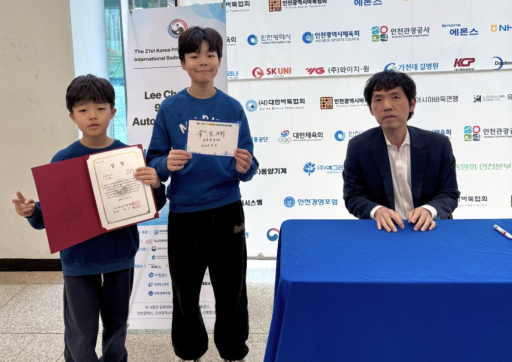
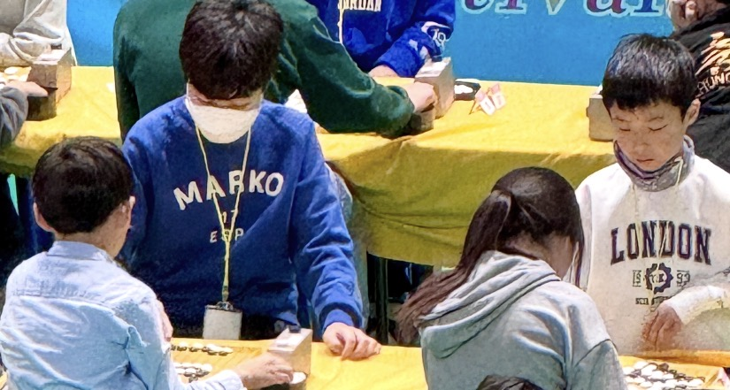
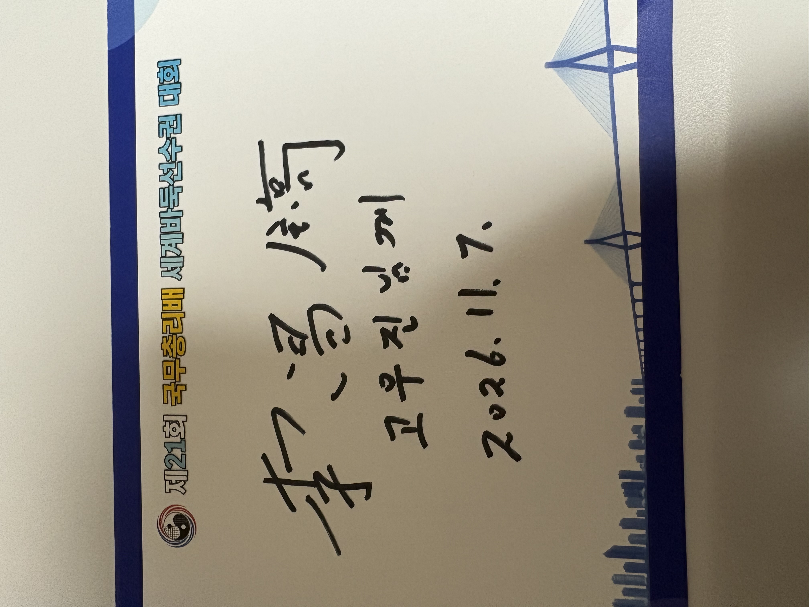

Today I went to 제 21회 국무총리배 세계바둑선수권 대회 which means the 21th prime minister world wide baduk competition (I translated this). Unfortunately, I met young people in the tournement, where you might think it would be good to win, but thinking like this would change your mind; "how did these people come to high place even though they are young", which they must have been training only 'baduk' but nothing else where they must be studying for 40 hours a week. These caused me 0-3 (0 win 3 loses) in the competition, but I have learned one 포석 which is opening technique from others, and moreover, I met 이창호 which is like a legend of baduk, got sign and photo from him which I think I earned alot of things in this competition not just losing and earning some worthless participation award
